# 데이터 그래프 정리 (2026-11-23)

대상: `대회_학생용/train.parquet` (154,327행), `test.parquet` (111,563행). 노선 2, 211, 311, 704, B1.
그래프 이미지: `그래프/` 폴더 (20장). 만든 스크립트는 맨 아래에 적어 둠.

- Part 1 (1~6): 대회 데이터
- Part 2 (7~10): 실습 데이터
- Part 3 (11~12): 대회 train vs test
- Part 4 (13~18): 실험 결과
- Part 5 (19~20): 제출 파일

---

# Part 1. 대회 데이터

## 1. 날짜별 행 수

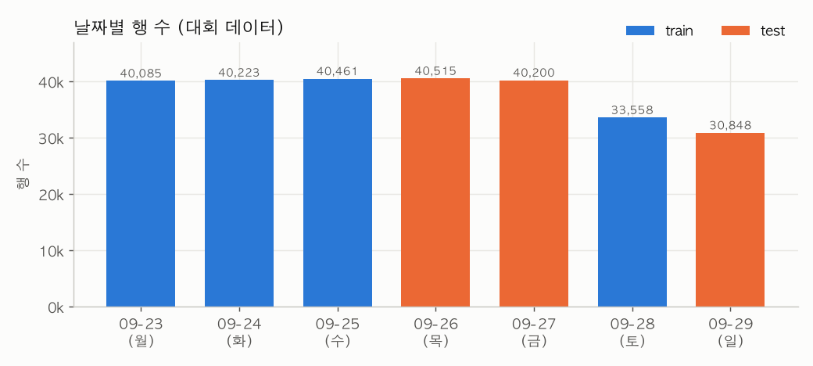

| 날짜 | 요일 | 구분 | 행 수 |
|---|---|---|---|
| 09-23 | 월 | train | 40,085 |
| 09-24 | 화 | train | 40,223 |
| 09-25 | 수 | train | 40,461 |
| 09-26 | 목 | test | 40,515 |
| 09-27 | 금 | test | 40,200 |
| 09-28 | 토 | train | 33,558 |
| 09-29 | 일 | test | 30,848 |

- 평일은 하루 약 4만 행으로 거의 같음. 토·일은 배차가 줄어서 행 수도 적음.
- **train에 일요일이 없음.** test 일요일(30,848행, test의 28%)은 처음 보는 요일.

## 2. tt_sec 분포

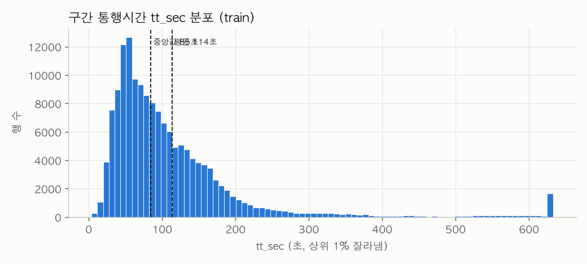

| 평균 | 중앙값 | 25% | 75% | 99% | 최대 |
|---|---|---|---|---|---|
| 113.5초 | 85초 | 54초 | 135초 | 633초 | 1,799초 |

- 오른쪽으로 꼬리가 긴 분포. 평균이 중앙값보다 28초 큼.
- 채점이 MAE라서 평균보다 **중앙값 쪽으로 맞추는 게 유리함** (L1 / log 변환 학습이 잘 먹히는 이유).

## 3. 시간대별 평균 통행시간 (요일별)

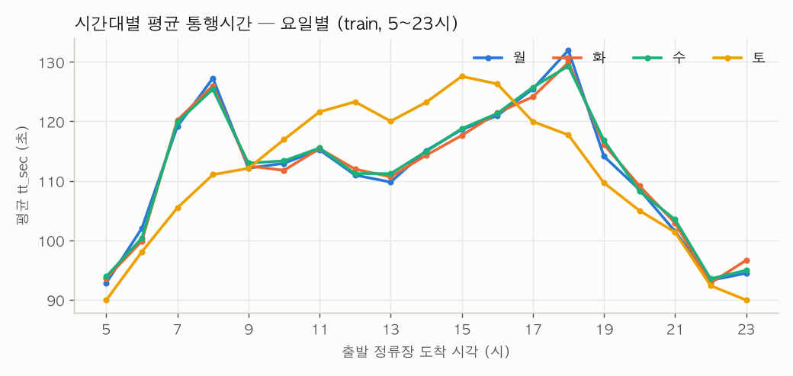

- 평일(월·화·수)은 세 줄이 거의 겹침 → **출근 8시, 퇴근 18시**에 두 번 올라감.
- 토요일은 모양이 다름: 아침 피크가 없고 **12~16시 낮에 가장 느림** (최고 15시 127.6초).
- 일요일 예측은 평일보다 토요일 모양에 가까울 가능성이 큼.
- 0시(354행)는 막차 구간이라 평균이 140~160초로 튀어서 그래프에서는 뺌.

## 4. 노선별 비교

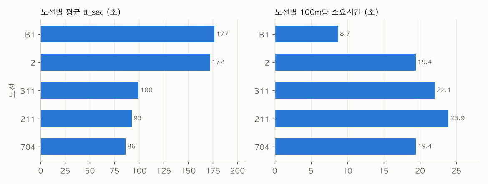

| 노선 | 행 수 | 구간(출발 정류장) 수 | 평균 거리 | 평균 tt_sec | 100m당 |
|---|---|---|---|---|---|
| 704 | 37,114 | 139 | 444m | 86.3초 | 19.4초 |
| 211 | 25,500 | 83 | 387m | 92.7초 | 23.9초 |
| 311 | 54,091 | 107 | 452m | 99.6초 | 22.1초 |
| 2 | 18,319 | 56 | 887m | 172.2초 | 19.4초 |
| B1 | 19,303 | 50 | 2,025m | 176.8초 | 8.7초 |

- 2번·B1은 정류장 간격이 길어서 구간 시간이 김.
- B1은 100m당 8.7초로 다른 노선의 절반 이하 → 정류장 사이가 먼 **고속 구간 위주 노선**. 거리만으로는 노선 차이를 설명 못 함.

## 5. 거리 구간별 통행시간

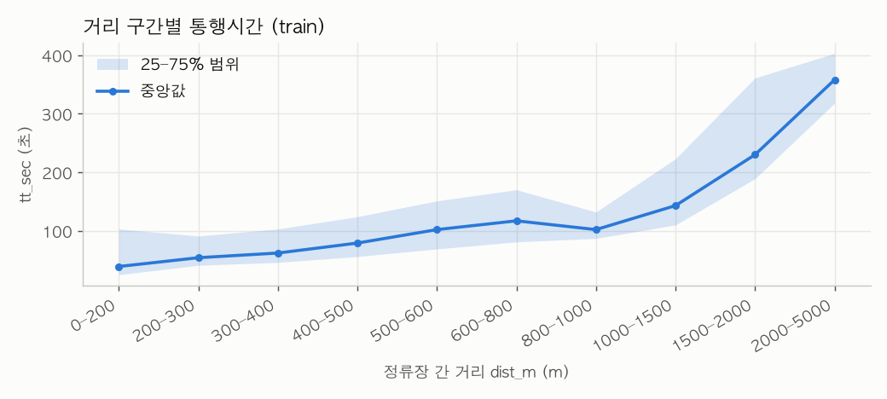

- 거리와 tt_sec 상관계수 **0.64**. 거리가 가장 강한 단서지만 그것만으로는 부족함.
- 800~1000m 구간이 600~800m보다 오히려 빠름 → 노선(B1 같은 빠른 구간)이 섞인 효과.
- 0~200m 구간은 25~75% 범위 위쪽이 넓음 → 짧아도 **종점·회차 정차시간**이 들어간 구간이 있음.

## 6. 노선·방향별 분포

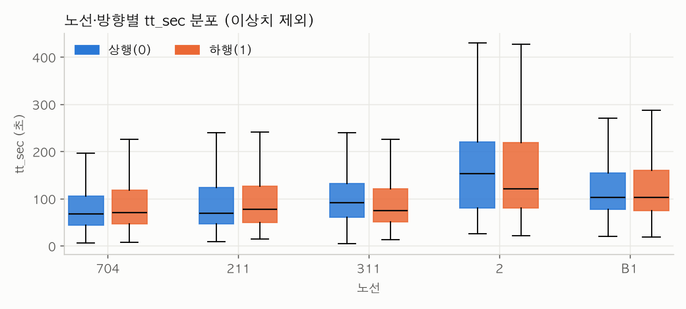

- 2번 노선이 흩어짐이 가장 큼 (상자 범위 약 80~220초). 2번 상행 중앙값이 하행보다 높음.
- 311은 상행이 더 느리고, 704·211·B1은 방향 차이가 작음.

---

# Part 2. 실습 데이터

`실습용/train.parquet` (109,891행) + `test.parquet` (79,942행, 정답 있음). 노선 1, 102, 511, 605.

## 7. 실습 날짜별 행 수

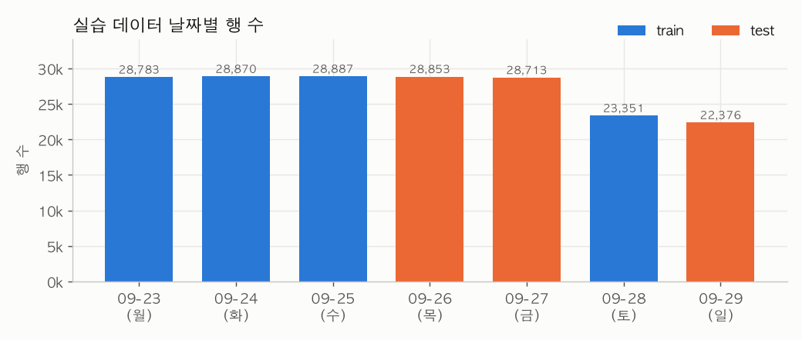

| 월 | 화 | 수 | 목 | 금 | 토 | 일 |
|---|---|---|---|---|---|---|
| 28,783 | 28,870 | 28,887 | 28,853 | 28,713 | 23,351 | 22,376 |

- 대회 데이터와 날짜 구성이 똑같음 (train 월·화·수·토 / test 목·금·일). 대회보다 하루 1만 행 정도 적음.

## 8. tt_sec 분포: 실습 vs 대회

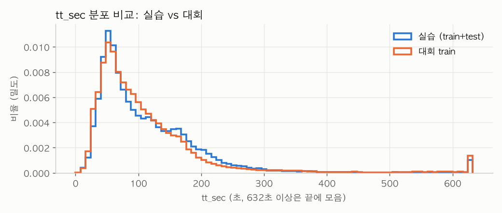

| | 평균 | 중앙값 | 25% | 75% |
|---|---|---|---|---|
| 실습 (train+test) | 115.7초 | 88초 | 55초 | 149초 |
| 대회 train | 113.5초 | 85초 | 54초 | 135초 |

- 두 분포 모양은 거의 같음. 실습은 150~200초 근처에 작은 봉우리가 하나 더 있음 (정류장 간격이 긴 1번 노선 영향).
- 맨 오른쪽 막대는 632초 이상을 모은 것 → 두 데이터 모두 1% 정도는 아주 긴 구간(회차·대기)임.

## 9. 실습: 평일·토·일 시간대별 (일요일 실제 모습)

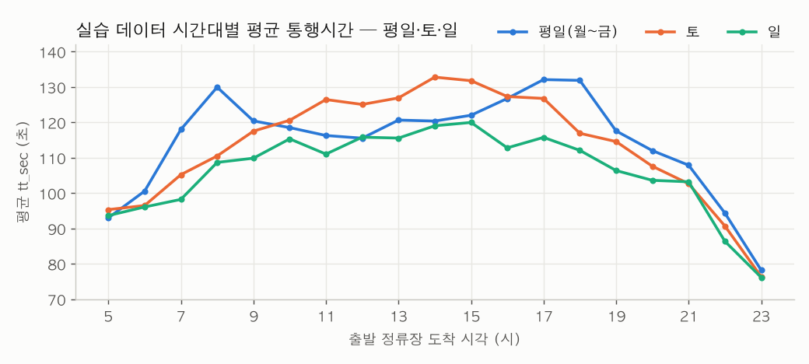

| | 평일(월~금) | 토 | 일 |
|---|---|---|---|
| 하루 평균 tt_sec | 116.9초 | 115.2초 | **108.0초** |

- 실습 test에는 정답이 있어서 **일요일 실제 패턴**을 볼 수 있음.
- 일요일은 토요일처럼 낮(10~15시)이 가장 느리지만, 전체적으로 토요일보다 5~13초 빠름. 출퇴근 피크는 없음.
- 그래서 "일요일 = 토요일처럼 + 평일처럼 반반 섞기"(E35)가 잘 먹힌 것과 맞아떨어짐.
- ⚠️ 실습 test 일요일과 대회 test 일요일은 같은 날(9/29)이라, 이 정답을 대회 예측에 직접 쓰는 건 규칙 위험이 있음.

## 10. 실습 노선별

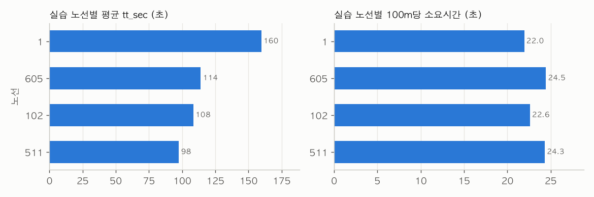

| 노선 | 행 수 | 평균 거리 | 평균 tt_sec | 100m당 |
|---|---|---|---|---|
| 511 | 36,200 | 401m | 97.6초 | 24.3초 |
| 102 | 81,935 | 480m | 108.5초 | 22.6초 |
| 605 | 41,954 | 467m | 114.1초 | 24.5초 |
| 1 (급행) | 29,744 | 728m | 159.7초 | 22.0초 |

- 실습 노선은 100m당 22~25초로 비슷함. 대회의 B1(8.7초)처럼 튀는 노선이 없음.

---

# Part 3. 대회 train vs test

## 11. 노선별 행 수

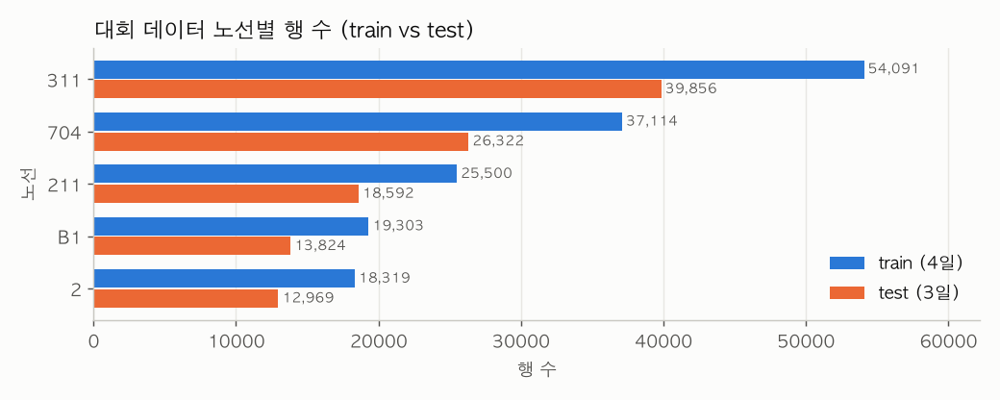

- 다섯 노선 모두 test 행 수가 train의 약 72%로 비율이 같음. 노선 구성은 train과 test가 똑같음.

## 12. 시간대별 운행 기록 수

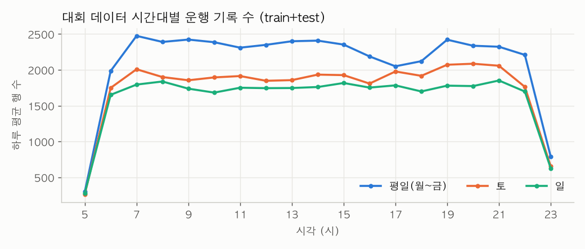

- 평일은 시간당 약 2,400행, 토 약 1,900행, 일 약 1,750행 (배차가 줄어든 만큼 적음).
- 평일 16~18시에 기록 수가 줄어드는 건 퇴근길 정체로 한 바퀴 도는 데 시간이 더 걸리기 때문으로 보임 (3번 그래프의 18시 피크와 같은 시간대).

---

# Part 4. 실험 결과

출처: `bis-travel-time-practice/experiments/` (`results.csv`, `E47_cv_table.csv`, `turn_rule_*.csv`, `E37_saturday_check.csv`, `E51_cv_table.csv`).
`예상` = 평일 MAE × 0.72 + 토 MAE × 0.28 (test가 목·금 72%, 일 28%라서). 낮을수록 좋음.

## 13. 실습 단계 실험 흐름 (E0 → E33)

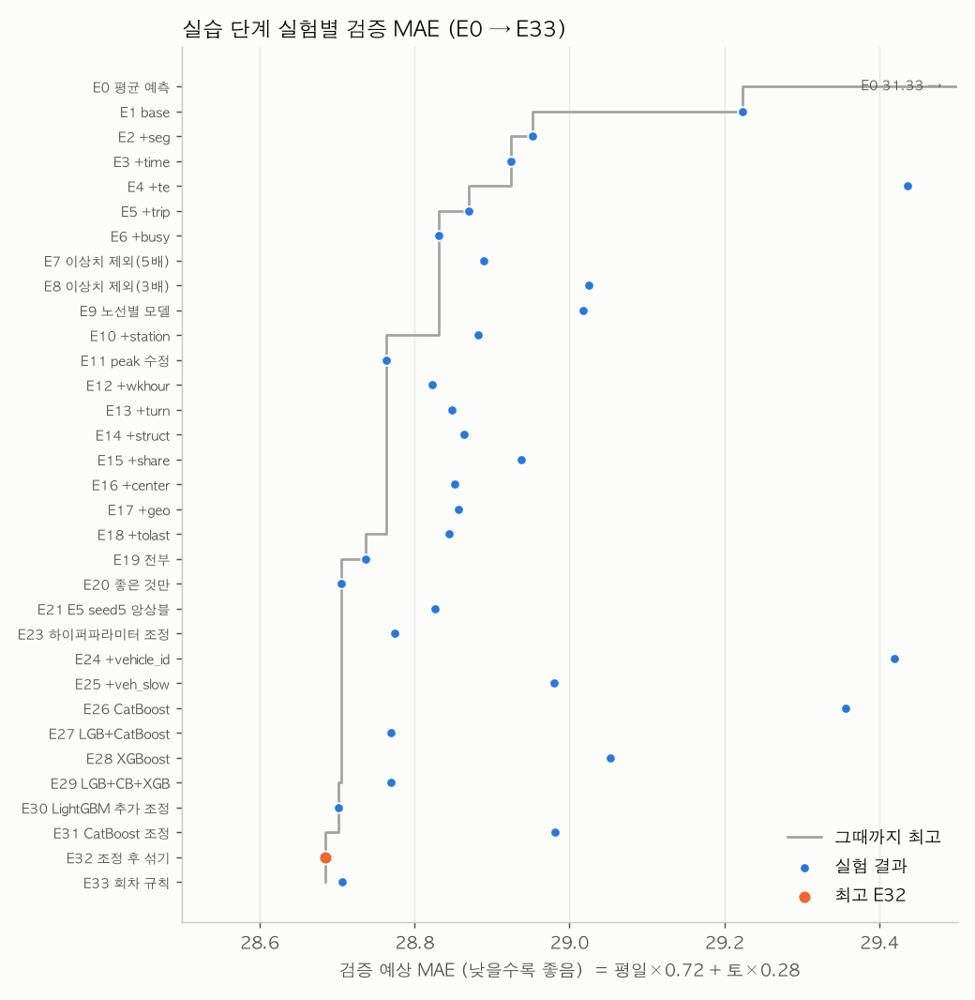

- 평균 예측 E0 31.33 → 모델 E1 29.22로 크게 떨어지고, 이후로는 피처 하나에 0.01~0.1씩 내려감.
- 회색 계단선 = 그때까지의 최고 점수. **최고는 E32 (LGB+CatBoost 조정 후 섞기) 28.685.**
- 크게 나빠진 실험: E4 타깃 인코딩(29.44), E24 차량 ID(29.42), E26 CatBoost 단독(29.36) → 과적합.

## 14. 대회 단계 실험 (E38 → E50)

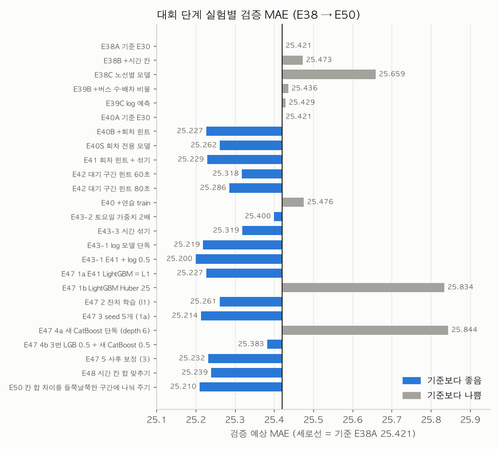

- 기준(E38A, 실습 E30 설정 그대로) 25.421.
- 가장 크게 좋아진 것: **회차 힌트**(E40B, −0.194). 이후 실험들은 대부분 이 위에서 0.01~0.03 차이.
- 최저 점수: E43-1 E41 + log 0.5 섞기 **25.200**, E50 25.210, E47-3 seed 5개 25.214.
- 나빠진 것: Huber 손실(25.834), 새 CatBoost 단독(25.844), 노선별 모델(25.659).
- 그래프에서 뺀 것: E39D 1m당 초 예측(45.989, 너무 나빠서 축 밖), 예상 점수가 없는 E44·E45·E46·E49·E51.

## 15. 대회 제출 public MAE 기록

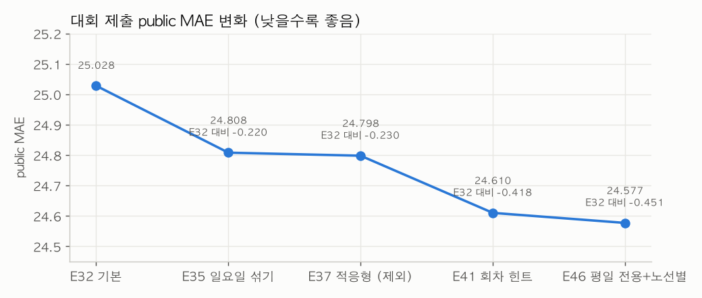

| 제출 | public MAE | E32 대비 |
|---|---|---|
| E32 기본 | 25.028 | — |
| E35 일요일 섞기 | 24.808 | −0.220 |
| E37 적응형 (최종 후보 제외) | 24.798 | −0.230 |
| E41 회차 힌트 | 24.610 | −0.418 |
| **E46 평일 전용 + 노선별 일요일** | **24.577** | **−0.451** |

- 가장 큰 두 번의 개선은 **일요일 처리(−0.22)**와 **회차 힌트(−0.20)**.
- E47 best는 아직 public 점수가 메모에 없음.

## 16. E47 실험: E41 최종 대비

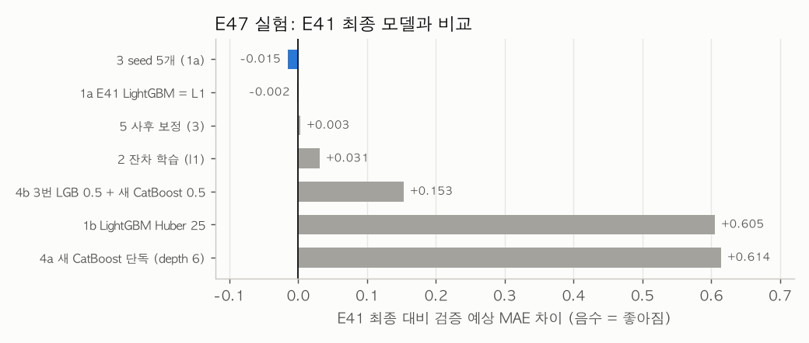

- 좋아진 건 **seed 5개 평균(−0.015)**뿐이고, 나머지는 같거나 나빠짐. → E47 best는 "LightGBM L1 seed 5개" 선택 (`E47_choice.json`, 예상 25.214).

## 17. 회차 구간 규칙 섞기 (E33)

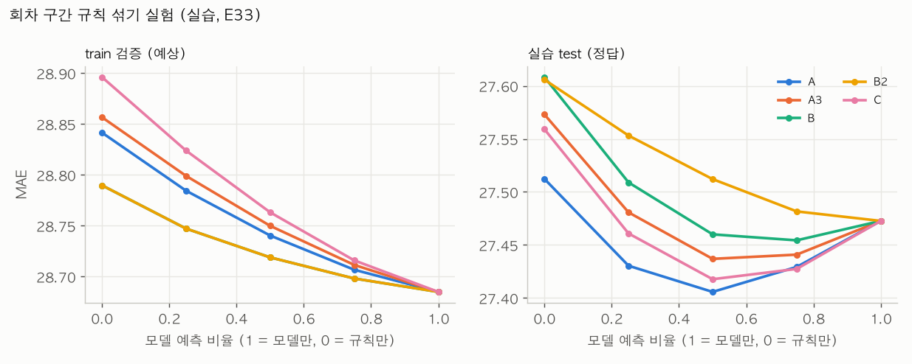

- 회차 구간을 "노선×시간 평균" 같은 규칙으로 예측해서 모델과 섞어 본 실험.
- **train 검증(왼쪽)**: 규칙을 섞을수록 계속 나빠짐 → 모델만(1.0) 쓰는 게 최고. (B와 B2는 검증 점수가 똑같아서 선이 겹침)
- **실습 test(오른쪽)**: 모델 0.5 + 규칙 0.5가 가장 좋음 (A 27.406 vs 모델만 27.473).
- 검증과 test 결과가 반대 → 믿기 어려워서 규칙 대신 회차 **힌트 피처**(E40B)로 방향을 바꿈.

## 18. E37 토요일 점검 · E51 직전 시간대 피처

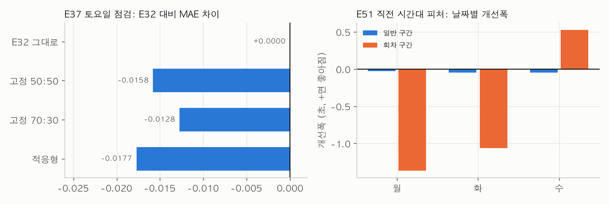

- **E37 (왼쪽)**: 토요일에 섞기 방식을 대 봤을 때 차이가 −0.018 이하로 아주 작음. 적응형이 제일 좋지만 고정 50:50과 거의 같음.
- **E51 (오른쪽)**: 직전 시간대 이동 피처를 넣으면 평일 3일 모두 **나빠짐** (평균 −0.047초). 회차 구간은 월·화 −1.0초 이상 나빠짐 → 채택 안 함.

---

# Part 5. 제출 파일

## 19. 최종 제출(E47 best) 예측값

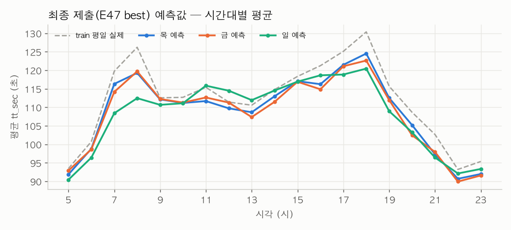

- 목·금 예측은 train 평일 실제 모양(점선)을 그대로 따라감. 8시·18시 피크도 있음.
- 일 예측은 아침 피크가 약하고 낮이 높아서 토요일과 평일의 중간 모양 → 9번 그래프의 실제 일요일 모양과 비슷함.
- 예측값은 실제 평균보다 전체적으로 3~5초 낮음. MAE로 학습해서 평균이 아니라 **중앙값 쪽으로 예측**하기 때문 (2번 그래프 참고).

## 20. 제출 파일끼리 비교 (E32 기본 대비)

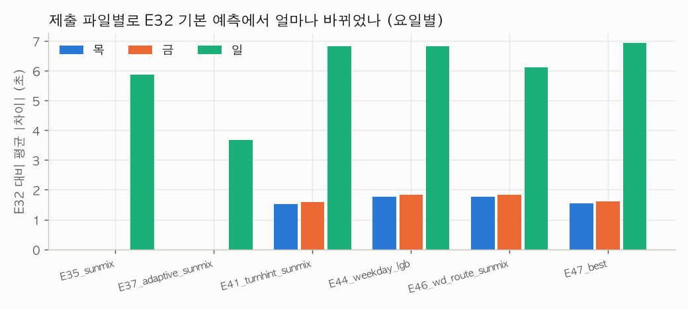

| 제출 | 목 | 금 | 일 |
|---|---|---|---|
| E35_sunmix | 0.00 | 0.00 | 5.88 |
| E37_adaptive_sunmix | 0.00 | 0.00 | 3.67 |
| E41_turnhint_sunmix | 1.53 | 1.59 | 6.81 |
| E44_weekday_lgb | 1.78 | 1.83 | 6.81 |
| E46_wd_route_sunmix | 1.78 | 1.83 | 6.11 |
| E47_best | 1.55 | 1.61 | 6.93 |

(단위: E32 예측과의 평균 절대 차이, 초)

- E35·E37은 **일요일만** 바꿈. E41부터 목·금도 조금씩 바뀜.
- 일요일 예측이 E32에서 평균 6~7초 바뀌었고, 이게 public 점수 개선의 대부분을 만듦.

---

### 다시 만들기

```bash
python3 -m venv venv && venv/bin/pip install pandas matplotlib pyarrow
venv/bin/python 그래프/make_charts.py  "/Users/kimjuwon/Desktop/에모팀플"   # 1~6번
venv/bin/python 그래프/make_charts2.py "/Users/kimjuwon/Desktop/에모팀플"   # 7~20번
```
